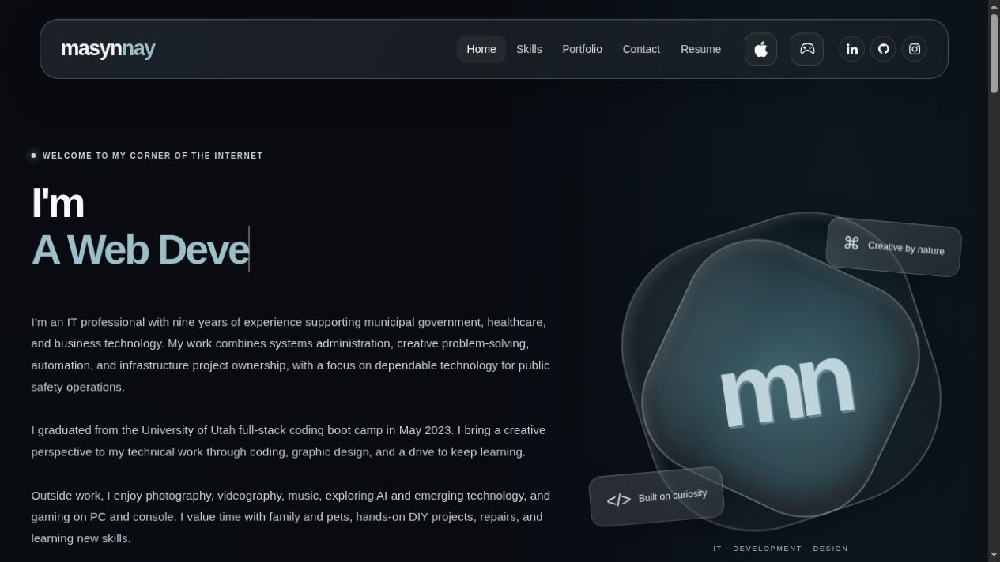
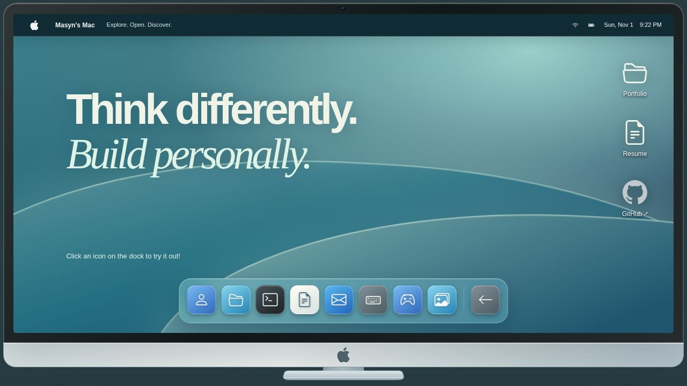
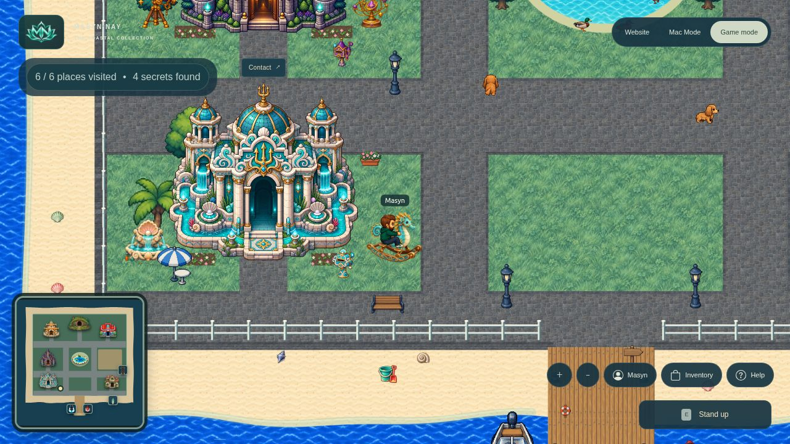

# Coastal Portfolio

My personal portfolio, rebuilt with React, JavaScript and CSS. It brings together my work in IT, automation and web development, with three ways to explore: a glass website, a Mac-inspired workspace, and a playable coastal island.

The original [React Portfolio](https://github.com/MasynNay/React-Portfolio) is preserved as its own demo. This is the next version, rather than a replacement of that project's history.

## Table of Contents

- [User Story](#user-story)
- [What Changed](#what-changed)
- [Acceptance Criteria](#acceptance-criteria)
- [Installation](#installation)
- [Application Demonstration](#application-demonstration)
- [Live Application](#live-application)
- [Credits](#credits)

## User Story

```text
AS someone exploring my work
I WANT to learn about my experience, skills and projects
SO THAT I can see what I do and connect with me.

AS someone who wants to take the scenic route
I WANT to explore the same portfolio through a desktop or a game
SO THAT the experience feels personal and gives me something to discover.
```

## What Changed

| Original portfolio | Coastal Portfolio |
| --- | --- |
| Space-themed scrolling page | Dark glass layout with ocean accents |
| Skills carousel | Grouped skills, including infrastructure, automation and AI workflows |
| Earlier career details | Shared current experience, achievements and Resume information |
| External project links | Project previews and local demos for MixStream, TypeNinja and SemiSnitch |
| Hidden arcade | Pocket Arcade with cartridge selectors, plus a Mac Games app |
| One presentation | Website, Mac Mode and Game Mode sharing the same professional content |
| Static navigation | A coastal town with rooms, characters, pets, collectibles and activities |

Mac Mode includes independent app windows, a live wallpaper, a photo slideshow, games and a TypeNinja typing test. Game Mode uses Canvas 2D, with family characters, costumes, duck flights, axolotl surfing, fishing, bikes, boats, wakeboarding, a skateboard and beach activities, including a directional animated dragon kite and seven-second sandcastle construction.

The island has 500 bugs across five equally likely groups, 250 aquatic species with freshwater and saltwater habitats, and 50 seashell varieties. Duplicate catches increase quantities. A shared field guide records discoveries, even after a creature is released. Collections and scores stay on the visitor's device.

Small games around town include the Avatar-inspired Element Runner with four elemental power-ups, Orc Hunt with archery and animated targets, Poké Ball Match with swipe swaps and special combo balls, Wind Waker-inspired Windfall 2048, Wizard Memory and Axolotl Drift. The glass-float hunt hides 20 colored floats in new locations around the town and its beaches whenever a fresh search begins.

## Acceptance Criteria

```text
GIVEN the portfolio
WHEN I choose a presentation
THEN I can find the same skills, projects, experience and contact information.

WHEN I open Mac Mode
THEN I can explore apps in their own windows and return to the main site.

WHEN I enter Game Mode
THEN I can explore the island, visit portfolio rooms and discover activities.

WHEN I use a phone or tablet
THEN I can tap to walk, double-tap to run, pinch to zoom and use touch actions.

WHEN I collect something
THEN my quantities and field guide discoveries are saved on this device.
```

## Installation

```sh
npm ci
npm start
```

Open the local address printed in the terminal. The main site is at `/`, Mac Mode at `/design/desktop`, Game Mode at `/world`, and the preserved original at `/React-Portfolio/`.

```sh
npm run check:project
npm run format:check
npm run lint
CI=true npm test -- --watchAll=false --runInBand
npm run build
```

The build produces static files in `build/`. It does not require a game server, a database or an account. GBA cartridges use a self-hosted EmulatorJS/mGBA player, with eleven supplied games and no external advertising pages. The first build downloads verified cartridge archives from the project’s public release assets. See the [arcade guide](docs/ARCADE.md) for hosting, controls, saves and runtime licenses.

For directory responsibilities, sprite artwork, photo imports, formatting and game controls, see the [development guide](docs/DEVELOPMENT.md) and [world guide](src/world/README.md). Build settings, publishing and rollback are covered in the [deployment guide](docs/DEPLOYMENT.md).

## Application Demonstration

| Website | Mac Mode | Game Mode |
| --- | --- | --- |
|  |  |  |

The earlier portfolio keeps its original branding and project screenshots, so it can be compared with this redesign.

## Live Application

- [masynnay.com](https://masynnay.com)
- [Anything Plays — cross-platform camera-controlled desktop software](https://anythingplays.masynnay.com/) ([source](https://github.com/MasynNay/anything-plays); stable 2.0 released, 3.0 in active QA)
- [Original portfolio demo](https://masynnay.github.io/React-Portfolio/)
- [Source repository](https://github.com/MasynNay/Coastal-Portfolio)

## Credits

Created by [Masyn Nay](https://github.com/MasynNay). The project demos retain the context and credits of the original boot camp group projects. Source artwork and attribution records are kept under [docs/source-assets](docs/source-assets) and [docs/licenses](docs/licenses).

This is a personal portfolio with fan-inspired costumes and activities. It is not affiliated with the franchises referenced in those designs.
