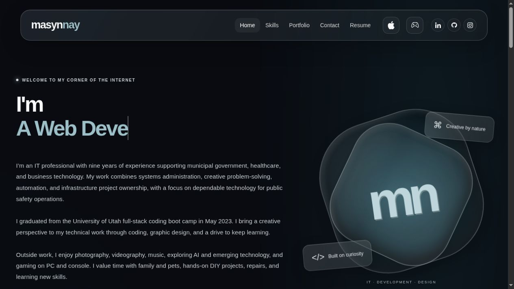
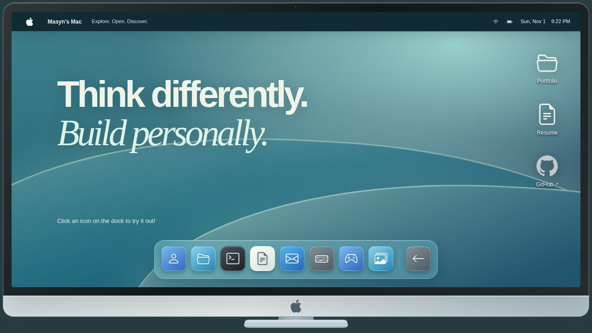
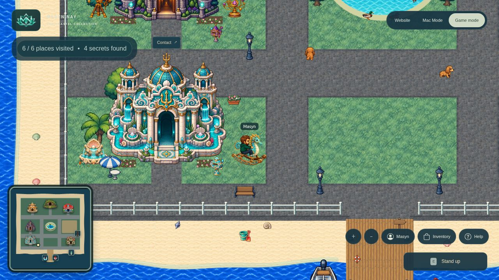

# Coastal Portfolio

My personal portfolio, rebuilt with React, JavaScript and CSS. It brings together my work in IT, automation and web development, with three ways to explore: a glass website, a Mac-inspired workspace, and a playable coastal island.

The original [React Portfolio](https://github.com/MasynNay/React-Portfolio) is preserved as its own demo. This is the next version, rather than a replacement of that project's history.

## Table of Contents

- [User Story](#user-story)
- [What Changed](#what-changed)
- [Acceptance Criteria](#acceptance-criteria)
- [Installation](#installation)
- [Application Demonstration](#application-demonstration)
- [Live Application](#live-application)
- [Credits](#credits)

## User Story

```text
AS someone exploring my work
I WANT to learn about my experience, skills and projects
SO THAT I can see what I do and connect with me.

AS someone who wants to take the scenic route
I WANT to explore the same portfolio through a desktop or a game
SO THAT the experience feels personal and gives me something to discover.
```

## What Changed

| Original portfolio          | Coastal Portfolio                                                        |
| --------------------------- | ------------------------------------------------------------------------ |
| Space-themed scrolling page | Dark glass layout with ocean accents                                     |
| Skills carousel             | Grouped skills, including infrastructure, automation and AI workflows    |
| Earlier career details      | Shared current experience, achievements and Resume information           |
| External project links      | Project previews and local demos for MixStream, TypeNinja and SemiSnitch |
| Hidden arcade               | Pocket Arcade with cartridge selectors, plus a Mac Games app             |
| One presentation            | Website, Mac Mode and Game Mode sharing the same professional content    |
| Static navigation           | A coastal town with rooms, characters, pets, collectibles and activities |

Mac Mode includes independent app windows, a live wallpaper, a photo slideshow, games and a TypeNinja typing test. Game Mode uses Canvas 2D, with family characters, costumes, duck flights, axolotl surfing, fishing, bikes, boats, wakeboarding, a skateboard and beach activities, including a directional animated dragon kite and seven-second sandcastle construction. The game canvas follows display density up to 2x, bounded to eight megapixels. Pixel-art sprites and UI previews use crisp sampling; the camera and touch input continue to use CSS coordinates.

ASCII is a terminal-style Mac dock app with a choice of animated bouquets and living aquariums. Eighteen bouquets are dedicated to my wife, Mi Shell, with distinct flower shapes, wrapping, and ribbons. Swipe, use the arrow buttons, or press the arrow keys to explore them. Pause and replay controls remain available.

ASCII has **six collections with 18 entries each**: Bouquets, Aquariums, Game Worlds, Galaxies, Storybook Worlds, and Nature & Nights—108 selections total. Game Worlds keeps six Pokémon, six Kingdom Hearts, and six Zelda scenes. Storybook Worlds adds moving castles, a delivery cat, a night bus, a sky bison, elven waterfalls, and other landmark vignettes. Nature & Nights includes forests, snowfall, northern lights, dunes, waterfalls, flowers, and mountain skies. The original gardens and lanterns remain available.

Game figures use locally compiled, colored ASCII cells from reviewed character references. Pokémon and Sora retain sampled animation poses with a stable palette and crop; character casts use a larger central figure and smaller companions. The original images are not hotlinked or loaded by visitors. [Reference credits and rebuild details](docs/AsciiArt.md) document the sources and conversion.

Every collection supports touch, keyboard navigation, direct scene selection, pause controls, reduced motion, and suspended playback when hidden. Scene-specific interactions include feeding, magic, hearts, fairies, wind, starlight pulses, nectar, and lantern releases.

The same studio opens from the Mac dock, the **ASCII Studio feature in Portfolio → Coding**, or the **back-left computer inside the Pokémon/Portfolio house** in Game Mode. Walk close to that computer and use the interaction button or E. The main portfolio dialog supports Escape and restores focus to its launch button.

The bouquet renderer adapts [Alish Sharma’s ASCII Flower Bouquet](https://github.com/alishsharma17/Ascii-Flower-Bouquet-) and retains its [MIT license](public/licenses/AsciiBouquet.txt). Aquarium models and rendering live in `src/ascii/`; the existing bouquet math remains in `src/bloom/`.

The island has 500 bugs across five equally likely groups, 250 aquatic species with freshwater and saltwater habitats, and 50 seashell varieties. Duplicate catches increase quantities. A shared field guide records discoveries, even after a creature is released. Collections and scores stay on the visitor's device.

Small games around town include the Avatar-inspired Element Runner with four elemental power-ups, Orc Hunt with archery and animated targets, Poké Ball Match with swipe swaps and special combo balls, Wind Waker-inspired Windfall 2048, Wizard Memory and Axolotl Drift. The glass-float hunt hides 20 colored floats in new locations around the town and its beaches whenever a fresh search begins.

## Acceptance Criteria

```text
GIVEN the portfolio
WHEN I choose a presentation
THEN I can find the same skills, projects, experience and contact information.

WHEN I open Mac Mode
THEN I can explore apps in their own windows and return to the main site.

WHEN I enter Game Mode
THEN I can explore the island, visit portfolio rooms and discover activities.

WHEN I use a phone or tablet
THEN I can tap to walk, double-tap to run, pinch to zoom and use touch actions.

WHEN I collect something
THEN my quantities and field guide discoveries are saved on this device.
```

## Installation

```sh
npm ci
npm start
```

Open the local address printed in the terminal. The main site is at `/`, Mac Mode at `/design/desktop`, Game Mode at `/world`, and the preserved original at `/React-Portfolio/`.

```sh
npm run check:project
npm run format:check
npm run lint
CI=true npm test -- --watchAll=false --runInBand
npm run build
```

The build produces static files in `build/`. It does not require a game server, a database or an account. GBA cartridges use a self-hosted EmulatorJS/mGBA player, with eleven supplied games and no external advertising pages. The first build downloads verified cartridge archives from the project’s public release assets. See the [arcade guide](docs/ARCADE.md) for hosting, controls, saves and runtime licenses.

For directory responsibilities, sprite artwork, photo imports, formatting and game controls, see the [development guide](docs/DEVELOPMENT.md) and [world guide](src/world/README.md). Build settings, publishing and rollback are covered in the [deployment guide](docs/DEPLOYMENT.md).

## Application Demonstration

| Website                             | Mac Mode                      | Game Mode                          |
| ----------------------------------- | ----------------------------- | ---------------------------------- |
|  |  |  |

The earlier portfolio keeps its original branding and project screenshots, so it can be compared with this redesign.

## Live Application

- [masynnay.com](https://masynnay.com)
- [Anything Plays — camera-controlled desktop gaming](https://anythingplays.masynnay.com/) ([download 3.0](https://github.com/MasynNay/anything-plays/releases/tag/v3.0.0) · [source](https://github.com/MasynNay/anything-plays))
- [Original portfolio demo](https://masynnay.github.io/React-Portfolio/)
- [Source repository](https://github.com/MasynNay/Coastal-Portfolio)

## Credits

Created by [Masyn Nay](https://github.com/MasynNay). The project demos retain the context and credits of the original boot camp group projects. Source artwork and attribution records are kept under [docs/source-assets](docs/source-assets) and [docs/licenses](docs/licenses).

This is a personal portfolio with fan-inspired costumes and activities. It is not affiliated with the franchises referenced in those designs.

## Island passport and collection room

Inventory now includes an **Island Passport**, **My Display Room**, and **Save Backup**. The passport builds on the existing visit/secret journal, adding collection milestones and unlockable room themes. The six display shelves reference items the visitor actually owns; rearranging a shelf never creates another catch or card.

Favorites and name/rarity sorting are available in the card binder and creature collections. Save Backup exports an island-only JSON file, previews imported progress, and asks the visitor to restore explicitly. It supports manual transfer between devices, including an unfinished card reveal. It is not cloud synchronization and does not include emulator save files.

The Help panel includes opt-in sound/volume controls and a Character Motion Studio. Ocean ambience and short original synthesized effects use a single audio context and suspend when the tab is hidden. The studio compares the existing walk/run artwork in eight directions, using Everyday Masyn as a consistent reference.

See [Island Life](docs/IslandLife.md) for the storage boundaries, progress rules, and verification notes.

## Workspace computer styles

The experience previously called Mac Mode is now **Workspace**. Open its system menu and choose **Customize Workspace** to select Mac, Windows, or Ubuntu styling alongside the existing wallpapers and bezel colors. Switching styles keeps app windows, game sessions, and content in place; the choice is saved on this device. These are interface styles for the same browser portfolio, not actual operating systems.

Mac retains its floating dock and left-side window controls. Windows uses a bottom taskbar and right-side window controls; Ubuntu uses a side launcher on wider screens and a touch-friendly bottom launcher on phones. Window dragging continues to use the same bounded pointer/keyboard implementation. The existing `/design/desktop` address remains available for bookmarks.

The Profile app introduces Masyn without the earlier casual greeting, ASCII uses its own flower icon, and Games puts Island Arcade before the Game Boy Advance library.

Each Workspace now has its own functional shell. Windows offers Start, search, pinned and alphabetical app lists, recent apps, Task View and the taskbar calendar. Ubuntu offers Activities, an application grid and a GNOME-style launcher. Mac offers Spotlight, Go/View/Window shortcuts and Control Center. The panels launch or restore the existing React app windows; they do not emulate or administer a real operating system. Quick Settings controls local wallpaper brightness, motion and desktop widget visibility. Custom wallpaper and bezel preferences continue to work across computer styles.

## Playground and creature habitats

The playground includes a trampoline and musical drums alongside the slide, seesaw, swings, climbing dome, picnic table and carousel. Equipment movement uses separate approach, ride and exit poses. Family residents have individual itineraries and reserve available equipment; player interactions take priority. Terrariums now support search and bug-group filtering. Household habitats share placement coordinates with the display room, with creature motion grounded on the surfaces of the actual enclosure artwork.

Release checks: `npm run format:check`, `npm run lint`, `npm run check:project`, `CI=true npm test -- --watchAll=false --runInBand`, and `npm run build`.
